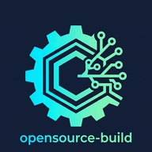

<div align="center">



# .github


<br/>


</div>

<br/>

## 🧭 About

> **Organization-level files for `opensource-build`.**

This is the special `.github` repository of the `opensource-build` organization. It holds the organization profile page and the default community files that apply across the organization's repositories.

<br/>

## 📁 Contents

```
.github/
├── profile/
│   ├── README.md          # Organization profile page
│   └── assets/            # Logo and marquee used by the profile
│       ├── logo-dark.svg
│       ├── logo-light.svg
│       └── marquee.svg
├── CONTRIBUTING.md        # Default contribution guidelines
└── README.md              # This file
```

| File | Purpose |
|---|---|
| 🏠 [`profile/README.md`](profile/README.md) | Rendered on the organization page. |
| 📘 [`CONTRIBUTING.md`](CONTRIBUTING.md) | Applied to every repository in the organization that does not define its own. |
| 🎨 `profile/assets/` | Static images referenced by the profile page. |

<br/>

## 🔗 How GitHub Uses These Files

- **Profile.** GitHub renders `profile/README.md` on the organization page. The repository must be public.
- **Defaults.** Community files placed in this repository act as organization-wide defaults. A repository that contains its own copy of the same file takes precedence.
- **Scope.** This `README.md` is documentation for this repository only and is not inherited.

<br/>

## 🛡️ Security Reporting

Do not disclose vulnerabilities in public issues. Use **Private Vulnerability Reporting** on the affected repository: open the **Security** tab and select **Report a vulnerability**. Further details are in [`CONTRIBUTING.md`](CONTRIBUTING.md#-security).

<br/>

## 🤝 Contributing

Contributions to this repository and to any repository in the organization are welcome. Read [`CONTRIBUTING.md`](CONTRIBUTING.md) before opening an issue or a pull request.

<br/>

## ⚖️ License

The files in this repository are released under the [MIT License](https://opensource.org/license/mit). Each repository in the organization declares its own license in its `LICENSE` file, and licenses may differ between projects.

<br/>

<div align="center">

<sub>🔓 Open by default. Built in the open.</sub>

<br/>

<a href="https://github.com/opensource-build"></a>

[⬆ Back to top](#github)

</div>
